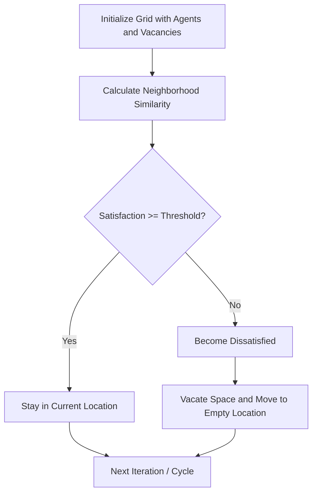
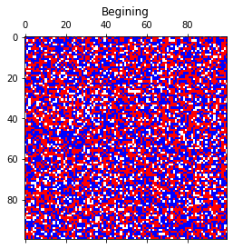
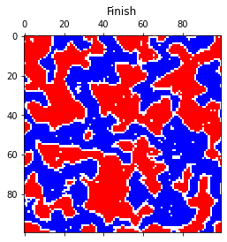
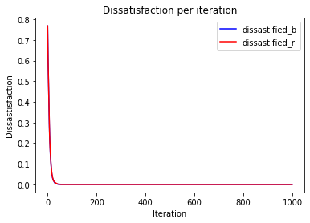
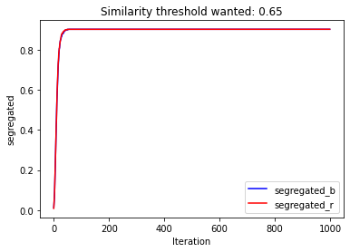

# Schelling's Model of Segregation Simulation


This project provides an interactive and highly optimized Python implementation of **Schelling's Model of Segregation**.

## 📖 What is Schelling's Model of Segregation?

Developed by economist Thomas Schelling in 1969, this model illustrates how macroscopic patterns (like severe segregation in housing) can emerge from microscopic interactions (individual preferences). 

The underlying mathematical logic relies on a similarity threshold ($\tau$). If an agent's neighborhood has a ratio of similar neighbors to total neighbors that falls below $\tau$, the agent becomes dissatisfied and moves to an empty space.

$$ \text{Satisfaction Condition: } \frac{N_{\text{similar}}}{N_{\text{total}}} \ge \tau $$

Even when agents are tolerant (e.g., they only require 30% of their neighbors to be like them), complete segregation often emerges.

## ⚙️ Model Simulation Cycle

The process of the agent-based simulation cycles through evaluating satisfaction and redistributing agents continuously:



## 🗂 Project Structure

- `optimized.py`: Contains a 2-agent model using 2D convolutions (via `scipy.signal.convolve2d`) for exceptionally fast grid evaluation, yielding visual results of agent satisfaction over iterations.
- `optimized (1).py`: An extended multi-agent model logic with balancing strategies ("fair" vs "majority").
- `test_optimized.py` & `test_optimized_1.py`: Pytest test suites ensuring the accuracy of initialization, threshold mechanisms, and boundary conditions.
- `animation.html` / `index.html`: Additional frontend/interactive presentations for the project.

## 🚀 Execution Instructions

First, ensure you have the required dependencies:
```bash
pip install numpy scipy matplotlib pandas IPython pytest
```

To run the basic two-agent optimization and observe the graph results:
```bash
python optimized.py
```

To run the extended multi-agent model:
```bash
python "optimized (1).py"
```

To run the test suite and verify the simulation logic:
```bash
python -m pytest
```

## 📊 Visual Outputs Example

Here are some simulation transitions from a randomized beginning to an end point with a satisfaction threshold of `0.65`:

<picture>
  <source alt="Beginning for Threshold of 0.65" media="(prefers-color-scheme: light)" srcset="./images/beggining_65.png">
  <source alt="Beginning for Threshold of 0.65" media="(prefers-color-scheme: dark)" srcset="./images/beggining_65_b.png">
  
</picture>

<picture>
  <source alt="Result for Threshold of 0.65" media="(prefers-color-scheme: light)" srcset="./images/finish_65.png">
  <source alt="Result for Threshold of 0.65" media="(prefers-color-scheme: dark)" srcset="./images/finish_65_b.png">
  
</picture>

### Dissatisfaction over time
<picture>
  <source alt="Dissatisfaction for Threshold of 0.65" media="(prefers-color-scheme: light)" srcset="./images/dissats_65.png">
  <source alt="Dissatisfaction for Threshold of 0.65" media="(prefers-color-scheme: dark)" srcset="./images/dissats_65_b.png">
  
</picture>

### Segregation scaling
<picture>
  <source alt="Segregation for Threshold of 0.65" media="(prefers-color-scheme: light)" srcset="./images/segregation_65.png">
  <source alt="Segregation for Threshold of 0.65" media="(prefers-color-scheme: dark)" srcset="./images/segregation_65_b.png">
  
</picture>

